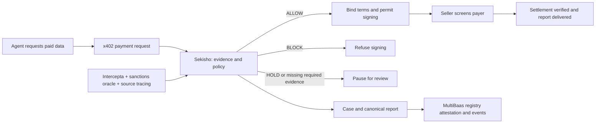

<a id="readme-top"></a>

<!-- PROJECT SHIELDS -->
[![CI][ci-shield]][ci-url]
[![Contributors][contributors-shield]][contributors-url]
[![Forks][forks-shield]][forks-url]
[![Stargazers][stars-shield]][stars-url]
[![Issues][issues-shield]][issues-url]
[![MIT License][license-shield]][license-url]

<!-- PROJECT LOGO -->
<br />
<div align="center">
  <a href="https://github.com/MarcusC-ops/sekisho">
    
  </a>

  <h3 align="center">Sekisho 関所</h3>

  <p align="center">
    A policy checkpoint for AI agent payments, before the signature.
    <br />
    <a href="docs/README.md"><strong>Explore the docs »</strong></a>
    <br />
    <br />
    <a href="https://sekisho-phi.vercel.app/try/">View Demo</a>
    &middot;
    <a href="https://github.com/MarcusC-ops/sekisho/issues/new?labels=bug&template=bug_report.md">Report Bug</a>
    &middot;
    <a href="https://github.com/MarcusC-ops/sekisho/issues/new?labels=enhancement&template=feature_request.md">Request Feature</a>
  </p>
</div>

<!-- TABLE OF CONTENTS -->
<details>
  <summary>Table of Contents</summary>
  <ol>
    <li>
      <a href="#about-the-project">About The Project</a>
      <ul>
        <li><a href="#what-is-verified">What Is Verified</a></li>
        <li><a href="#how-it-works">How It Works</a></li>
        <li><a href="#built-with">Built With</a></li>
      </ul>
    </li>
    <li>
      <a href="#getting-started">Getting Started</a>
      <ul>
        <li><a href="#prerequisites">Prerequisites</a></li>
        <li><a href="#installation">Installation</a></li>
      </ul>
    </li>
    <li>
      <a href="#usage">Usage</a>
      <ul>
        <li><a href="#try-the-hosted-trial">Try the hosted trial</a></li>
        <li><a href="#run-locally">Run locally</a></li>
        <li><a href="#integrate-the-sdk">Integrate the SDK</a></li>
        <li><a href="#repository-map">Repository map</a></li>
      </ul>
    </li>
    <li><a href="#sponsor-integrations">Sponsor Integrations</a></li>
    <li><a href="#roadmap">Roadmap</a></li>
    <li><a href="#contributing">Contributing</a></li>
    <li><a href="#license">License</a></li>
    <li><a href="#contact">Contact</a></li>
    <li><a href="#acknowledgments">Acknowledgments</a></li>
  </ol>
</details>

<!-- ABOUT THE PROJECT -->
## About The Project

[![Recorded hosted testnet evidence: one paid purchase and one payment stopped before signing][product-screenshot]](https://sekisho-phi.vercel.app/try/)

Sekisho screens the other party in an x402 payment, applies a deterministic policy,
and permits, pauses or refuses signing. It preserves the evidence behind that decision
and records a report fingerprint onchain through Curvegrid MultiBaas.

Why a checkpoint before the signature:
* An AI agent can pay a seller's wallet in seconds, but a convincing payment request says nothing about whether that wallet carries known risk signals.
* Once a payment settles it is hard to undo. Checking first lets an owner allow a purchase, pause it for human review, or refuse it.
* Payment teams need a record of what they knew when they acted, bound to the exact recipient, amount, token and network.

Built for ETHGlobal Tokyo 2026. This is a testnet prototype and demo policy, not a
certified compliance programme or a guarantee that a wallet is safe.

### What Is Verified

| Path | Observed result on 26 September 2026 |
|---|---|
| Hosted allowed purchase | Live screening → ALLOW → exact 0.05 test USDC settled → seller's sample report delivered |
| Hosted flagged purchase | Live risk evidence → BLOCK → REFUSED before payment signing |
| Decision evidence | Both report hashes checked; registry attestations confirmed and indexed; genuine webhooks delivered |
| Persistence | Both completed runs and their budget reservations survived a Render redeployment |
| Escrow contracts | Separate operator-driven deposit, premature-release rejection, clearance/release and refund rehearsal |

The **complete provider-triggered HOLD-to-escrow workflow remains unverified**.
The public HOLD outcome only pauses signing; it does not deposit into escrow.
The operator console is a separate private application, not an anonymously exposed service.
Full transaction links, addresses, limits and test scope are in
[LIVE-EVIDENCE.md](docs/LIVE-EVIDENCE.md) and [readiness.md](docs/readiness.md).

### How It Works



The decision is bound to the recipient, amount, token and payment network. ALLOW is
permission to sign, not proof of settlement. The receipt verifier separately checks
the successful transaction and matching USDC transfer. The report hash establishes
byte consistency, not truth of the upstream risk signals. AI-generated explanations
cannot change the policy verdict; the hosted demo uses `LLM_PROVIDER=none`.

### Built With

* [![Python][Python-shield]][Python-url] [![FastAPI][FastAPI-shield]][FastAPI-url] gate, SDK, agents and public runner
* [![Solidity][Solidity-shield]][Solidity-url] [![Foundry][Foundry-shield]][Foundry-url] [![OpenZeppelin][OpenZeppelin-shield]][OpenZeppelin-url] registry and escrow contracts
* [![Next.js][Next-shield]][Next-url] [![React][React-shield]][React-url] [![TypeScript][TypeScript-shield]][TypeScript-url] [![viem][viem-shield]][viem-url] private compliance console
* [![x402][x402-shield]][x402-url] [![Base Sepolia][Base-shield]][Base-url] [![MCP][MCP-shield]][MCP-url] payment protocol, testnet and agent tools
* [![Docker][Docker-shield]][Docker-url] [![SQLite][SQLite-shield]][SQLite-url] [![Render][Render-shield]][Render-url] [![Vercel][Vercel-shield]][Vercel-url] hosting and persistence

The static website is plain HTML, CSS and JavaScript modules with no build step.

<p align="right">(<a href="#readme-top">back to top</a>)</p>

<!-- GETTING STARTED -->
## Getting Started

### Prerequisites

* Python 3.11
* Node.js 22 and npm
* Git
* [Foundry](https://getfoundry.sh) for contract tests and deployment

### Installation

1. Clone the repository with its contract submodules
   ```sh
   git clone --recurse-submodules https://github.com/MarcusC-ops/sekisho.git
   cd sekisho
   ```
2. Install the Python virtual environment, submodules and console dependencies
   ```sh
   make install
   ```
3. Create your local environment file
   ```sh
   test -f .env || cp .env.example .env
   ```
4. Check the configuration offline; it never prints secrets
   ```sh
   make check-setup
   ```

Live screening needs provider keys, fresh testnet signers and deployed contracts.
[SETUP.md](docs/SETUP.md) walks through each one. Never put provider keys or signer
secrets in browser variables, and never send mainnet transactions.

<p align="right">(<a href="#readme-top">back to top</a>)</p>

<!-- USAGE EXAMPLES -->
## Usage

### Try the hosted trial

Open **https://sekisho-phi.vercel.app/try/**. Choose the standard vendor or flagged
recipient and select **Run real testnet trial**. No visitor wallet or API key is required.
The server funds a bounded 0.05 test-USDC purchase on Base Sepolia. Separately labelled
simulations remain available and never move money.

The public trial has persistent spending and request limits. If unavailable or exhausted,
it does not silently substitute a simulation. Recorded results remain visible on the page.

### Run locally

For credential-free UI development, run the console against synthetic fixtures. Its
banner identifies synthetic data; fixtures are not a live screening mode.

```sh
npm --prefix dashboard run dev:fixtures
```

With a configured `.env`, `make help` lists every service and demo target, including
`make gate`, `make vendors`, `make dashboard` and `make public-trial`.
[Public-trial deployment](docs/PUBLIC-TRIAL.md) uses one Render container and persistent
disk; the static website is served by Vercel. Only the limited runner and authenticated
webhook ingress are exposed publicly.

Verify a checkout before opening a pull request:

```sh
make test
npm --prefix dashboard run lint
npm --prefix dashboard run build
node --test website/try/state.test.mjs
node --test scripts/test-website-demo.mjs
```

### Integrate the SDK

Screen the counterparty before an agent signs. Anything other than ALLOW, including an
unreachable gate, means do not sign.

```python
from sekisho import SekishoClient, SekishoError

USDC = "0x036CbD53842c5426634e7929541eC2318f3dCF7e"


async def screen_payment(counterparty, gate_url="http://localhost:8000"):
    async with SekishoClient(gate_url) as gate:
        try:
            decision = await gate.screen(
                counterparty=counterparty,
                direction="outbound",
                amount="50000",  # 0.05 USDC, in atomic units
                asset=USDC,
                payment_chain_id=84532,  # Base Sepolia
                source="direct",
                agent_id="my-agent",
            )
        except SekishoError:
            return "HOLD"  # No usable decision: do not sign.
        return decision.verdict
```

This is the tested [screening example](sdk/examples/screen_before_signing.py). The
[SDK guide](sdk/README.md) covers the x402 payer and payee hooks and the MCP server;
the [API contract](docs/api.md) defines every request and response.

### Repository map

| Directory | Purpose |
|---|---|
| `gate/` | Screening adapters, deterministic policy, canonical reports, receipts, cases and audit events |
| `sdk/` | Python gate client and x402 payment hooks |
| `agents/` | Buyer, vendors, restricted public runner and local demo controls |
| `contracts/` | Registry, escrow, deployment script and Foundry tests |
| `dashboard/` | Private Next.js compliance console and development fixtures |
| `website/` | Public site and browser trial |
| `deploy/` | Persistent hosted stack |
| `scripts/` | Setup, testnet rehearsal and checks |
| `docs/` | Current operating documentation and verified evidence |
| `docs/archive/` | Historical specifications and plans retained for AI-development provenance |
| `docs/prompts/` | Recorded development instructions |

_For more, see the [documentation index](docs/README.md) and the [handoff notes](docs/HANDOFF.md)._

<p align="right">(<a href="#readme-top">back to top</a>)</p>

<!-- SPONSOR INTEGRATIONS -->
## Sponsor Integrations

### Intercepta: live evidence at the payment boundary

- [API adapter](gate/sekisho_gate/screening/intercepta.py) and
  [screening pipeline](gate/sekisho_gate/screening/pipeline.py).
- [x402 payer/payee hooks](sdk/sekisho/x402_hooks.py) enforce the decision before
  buyer signing and seller acceptance.
- Direct Quick Scan is live in the hosted trial. Wallet screening uses mainnet risk
  evidence while transfers use testnet USDC; token checks map to the configured
  mainnet equivalent. Supporting cached checks are explicitly labelled.
- Missing required evidence fails closed. The source-of-funds trace is sampled and
  bounded; no traced history is not proof of safety.

**API feedback from actual use:**
1. Live Quick Scan supplied usable score/traits for the flagged address and explicit zero-score responses for the buyer and fresh merchant.
2. Verbatim trait descriptions made the refusal understandable without asking an LLM to invent a risk interpretation.
3. A direct scan timed out and a traced funder returned 404; distinguishing unavailable evidence from a clean response is essential.
4. The product and documentation use different domains; response examples for unknown wallets and quota exhaustion would make integration clearer.
5. One endpoint accepting the x402 recipient, asset, amount and authorization together would reduce payment-specific integration work.

### Curvegrid: onchain decisions and event delivery

[MultiBaas client](gate/sekisho_gate/chain/multibaas.py) composes and submits signed
application contract calls. [Attestations](gate/sekisho_gate/chain/attest.py) record
screening decisions; [authenticated webhooks](gate/sekisho_gate/webhooks.py) update
case state. [Setup](scripts/setup_multibaas.py) configures USDC, event queries and
webhook delivery. Initial contract deployment uses Foundry; runtime application
writes use MultiBaas.

**Experience from actual use:**
- REST contract calls and indexed events let the Python gate integrate without a separate indexer.
- The deployed registry/escrow and genuine webhook deliveries are verified on Base Sepolia.
- ABI-only upload needed `bin: "0x"`; a null bytecode field was rejected.
- Transaction-hash event lookup occasionally returned no rows despite indexing; a bounded receipt-derived block/index lookup resolved the exact event.
- Event-query pages are limited to 50 rows. Totals must be paginated and labelled correctly: cumulative deposits are not outstanding escrow.

<p align="right">(<a href="#readme-top">back to top</a>)</p>

<!-- ROADMAP -->
## Roadmap

- [x] Hosted allowed purchase settled on Base Sepolia
- [x] Hosted flagged purchase refused before payment signing
- [x] Registry attestations, indexed events and genuine MultiBaas webhooks
- [x] Persistent public-trial budgets that survive redeployment
- [x] Escrow deposit, release and refund in a separate operator rehearsal
- [ ] Genuine provider-triggered HOLD through the gate and escrow, end to end
- [ ] Repeated live performance measurement (p50/p95)
- [ ] Production review of authentication, tenant isolation, signer custody, policy ownership, monitoring and recovery

See [readiness.md](docs/readiness.md) for scope and the [open issues][issues-url] for
proposed features and known issues.

<p align="right">(<a href="#readme-top">back to top</a>)</p>

<!-- CONTRIBUTING -->
## Contributing

Contributions are welcome. If you have a suggestion, fork the repo and open a pull
request, or open an issue with the tag "enhancement".

1. Fork the Project
2. Create your Feature Branch (`git checkout -b feature/AmazingFeature`)
3. Commit your Changes (`git commit -m 'Add some AmazingFeature'`)
4. Push to the Branch (`git push origin feature/AmazingFeature`)
5. Open a Pull Request

Before opening a pull request, run the checks under [Run locally](#run-locally) and read
[AGENTS.md](AGENTS.md). In particular:
* Never reformat `gate/policy/policy.yaml`; its exact bytes define the policy hash.
* Missing or failed required screening must never become ALLOW.
* Use fresh testnet keys only. Never commit credentials or send mainnet transactions.
* Keep fixtures and simulations labelled, and record AI assistance in [docs/ai-usage.md](docs/ai-usage.md).

### Top contributors:

<a href="https://github.com/MarcusC-ops/sekisho/graphs/contributors">
  
</a>

<p align="right">(<a href="#readme-top">back to top</a>)</p>

<!-- LICENSE -->
## License

Distributed under the MIT License. See [LICENSE](LICENSE) for more information.
Third-party dependencies and fonts retain their own licences.
[Asset provenance](docs/assets/README.md) distinguishes original artwork from labelled
fixture screenshots.

<p align="right">(<a href="#readme-top">back to top</a>)</p>

<!-- CONTACT -->
## Contact

Marcus Chia - [@MarcusC-ops](https://github.com/MarcusC-ops)

Project Link: [https://github.com/MarcusC-ops/sekisho](https://github.com/MarcusC-ops/sekisho)

Live demo: [https://sekisho-phi.vercel.app/try/](https://sekisho-phi.vercel.app/try/)

Additional team members, roles and social handles will be listed once confirmed.

<p align="right">(<a href="#readme-top">back to top</a>)</p>

<!-- ACKNOWLEDGMENTS -->
## Acknowledgments

* [ETHGlobal Tokyo 2026](https://ethglobal.com/events/tokyo2026)
* [Intercepta](https://intercepta.io/ethglobal) for live wallet risk evidence
* [Curvegrid MultiBaas](https://www.curvegrid.com/multibaas) for contract calls, indexed events and webhooks
* [x402](https://www.x402.org) and its public facilitator
* [Chainalysis sanctions oracle](https://go.chainalysis.com/chainalysis-oracle-docs.html) and [Blockscout](https://www.blockscout.com) for sanctions and source-of-funds data
* [OpenZeppelin Contracts](https://www.openzeppelin.com/contracts), [Foundry](https://getfoundry.sh) and [forge-std](https://github.com/foundry-rs/forge-std)
* [Inter Tight](https://github.com/rsms/inter-tight) and [Atkinson Hyperlegible Next](https://github.com/googlefonts/atkinson-hyperlegible-next), under the SIL Open Font License
* [Best-README-Template](https://github.com/othneildrew/Best-README-Template), [Shields.io](https://shields.io) and [contrib.rocks](https://contrib.rocks)

### Provenance and AI assistance

Claude Code and Codex assisted implementation, tests, documentation, design and deployment
under user direction. [AI usage](docs/ai-usage.md) identifies affected areas and remaining
human confirmations. Original specifications and planning records are in the
[archive](docs/archive/README.md); they are not current product promises.

The commercial pricing and customer-count examples in presentation material are
hypotheses, not revenue, traction or a measured total addressable market.

<p align="right">(<a href="#readme-top">back to top</a>)</p>

<!-- MARKDOWN LINKS & IMAGES -->
<!-- https://www.markdownguide.org/basic-syntax/#reference-style-links -->
[ci-shield]: https://img.shields.io/github/actions/workflow/status/MarcusC-ops/sekisho/ci.yml?branch=main&style=for-the-badge&label=CI
[ci-url]: https://github.com/MarcusC-ops/sekisho/actions/workflows/ci.yml
[contributors-shield]: https://img.shields.io/github/contributors/MarcusC-ops/sekisho.svg?style=for-the-badge
[contributors-url]: https://github.com/MarcusC-ops/sekisho/graphs/contributors
[forks-shield]: https://img.shields.io/github/forks/MarcusC-ops/sekisho.svg?style=for-the-badge
[forks-url]: https://github.com/MarcusC-ops/sekisho/network/members
[stars-shield]: https://img.shields.io/github/stars/MarcusC-ops/sekisho.svg?style=for-the-badge
[stars-url]: https://github.com/MarcusC-ops/sekisho
[issues-shield]: https://img.shields.io/github/issues/MarcusC-ops/sekisho.svg?style=for-the-badge
[issues-url]: https://github.com/MarcusC-ops/sekisho/issues
[license-shield]: https://img.shields.io/github/license/MarcusC-ops/sekisho.svg?style=for-the-badge
[license-url]: https://github.com/MarcusC-ops/sekisho/blob/main/LICENSE
[product-screenshot]: docs/assets/trial-evidence.png
[Python-shield]: https://img.shields.io/badge/Python-3776AB?style=for-the-badge&logo=python&logoColor=white
[Python-url]: https://www.python.org
[FastAPI-shield]: https://img.shields.io/badge/FastAPI-009688?style=for-the-badge&logo=fastapi&logoColor=white
[FastAPI-url]: https://fastapi.tiangolo.com
[Solidity-shield]: https://img.shields.io/badge/Solidity-363636?style=for-the-badge&logo=solidity&logoColor=white
[Solidity-url]: https://soliditylang.org
[Foundry-shield]: https://img.shields.io/badge/Foundry-1E1E1E?style=for-the-badge
[Foundry-url]: https://getfoundry.sh
[OpenZeppelin-shield]: https://img.shields.io/badge/OpenZeppelin-4E5EE4?style=for-the-badge&logo=openzeppelin&logoColor=white
[OpenZeppelin-url]: https://www.openzeppelin.com/contracts
[Next-shield]: https://img.shields.io/badge/Next.js-000000?style=for-the-badge&logo=nextdotjs&logoColor=white
[Next-url]: https://nextjs.org
[React-shield]: https://img.shields.io/badge/React-20232A?style=for-the-badge&logo=react&logoColor=61DAFB
[React-url]: https://react.dev
[TypeScript-shield]: https://img.shields.io/badge/TypeScript-3178C6?style=for-the-badge&logo=typescript&logoColor=white
[TypeScript-url]: https://www.typescriptlang.org
[viem-shield]: https://img.shields.io/badge/viem-FFC517?style=for-the-badge
[viem-url]: https://viem.sh
[x402-shield]: https://img.shields.io/badge/x402-1A1A1A?style=for-the-badge
[x402-url]: https://www.x402.org
[Base-shield]: https://img.shields.io/badge/Base_Sepolia-0052FF?style=for-the-badge&logo=coinbase&logoColor=white
[Base-url]: https://docs.base.org
[MCP-shield]: https://img.shields.io/badge/MCP-1A1A1A?style=for-the-badge&logo=modelcontextprotocol&logoColor=white
[MCP-url]: https://modelcontextprotocol.io
[Docker-shield]: https://img.shields.io/badge/Docker-2496ED?style=for-the-badge&logo=docker&logoColor=white
[Docker-url]: https://www.docker.com
[SQLite-shield]: https://img.shields.io/badge/SQLite-003B57?style=for-the-badge&logo=sqlite&logoColor=white
[SQLite-url]: https://www.sqlite.org
[Render-shield]: https://img.shields.io/badge/Render-46E3B7?style=for-the-badge&logo=render&logoColor=white
[Render-url]: https://render.com
[Vercel-shield]: https://img.shields.io/badge/Vercel-000000?style=for-the-badge&logo=vercel&logoColor=white
[Vercel-url]: https://vercel.com
